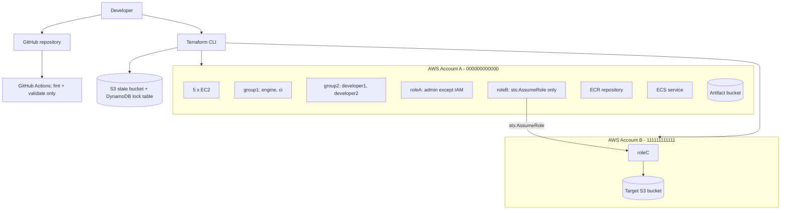
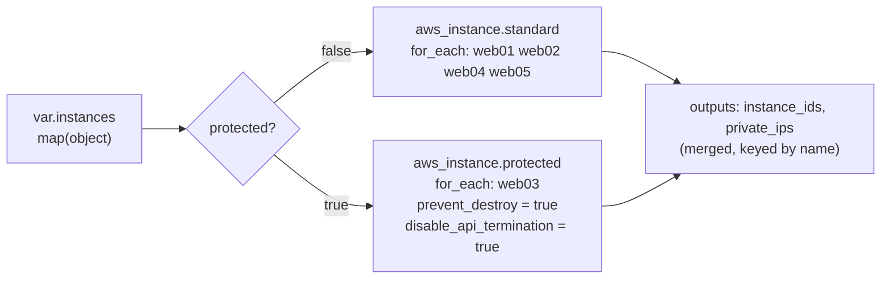

# aws-terraform-devops-assignment

Multi-account AWS infrastructure with Terraform: EC2 fleet, remote state with
locking, multi-account IAM, a least-privilege CI policy and a trust-policy bug fix.

> **Validation status:** code is developed and validated locally
> (`fmt`, `init -backend=false`, `validate`). **No `terraform apply` has been run
> against a real AWS account yet.** Real-AWS POC steps are documented separately
> and clearly marked.

## 1. Project overview

| Task | Topic | Status |
|---|---|---|
| 0 | Repository bootstrap, guardrails, safe CI | Done (local) |
| 1 | Five EC2 instances from one `map(object)` + `for_each`, `prevent_destroy` | Done (local POC); real-AWS POC pending |
| 2 | S3 remote state + DynamoDB locking (bootstrap stack) | Planned |
| 3 | Multi-account IAM: groups, users, roleA, roleB, roleC | Planned |
| 4 | CI least-privilege policy (ECR / ECS / S3 read) | Planned |
| 5 | Find and fix the roleC trust and S3 policy bugs | Planned |

## 2. Assignment requirements

See [NOTES.md](NOTES.md) for the written answers. `FINAL-CHECKLIST.md` (created at
the end) maps every requirement to its implementation and evidence.

## 3. Architecture



Details: [docs/architecture.md](docs/architecture.md).

## 4. Repository structure

```
bootstrap/     state bucket + lock table (local state, run once)
modules/ec2/   reusable multi-instance EC2 module
account-a/     Account A root module (EC2, IAM, roleA, roleB, CI policy)
account-b/     Account B root module (roleC, target bucket)
policies/      standalone JSON policy documents
tests/         per-task test procedures and evidence
docs/          architecture, testing, troubleshooting
scripts/       local helper scripts (Windows PowerShell)
.github/       CI workflow (safe checks only)
```

## 5. Prerequisites

| Tool | Version | Install (Windows) |
|---|---|---|
| Terraform | >= 1.5, < 2.0 | `winget install --id HashiCorp.Terraform -e` |
| Git | recent | `winget install --id Git.Git -e` |
| AWS CLI v2 | real-AWS phase only | `winget install --id Amazon.AWSCLI -e` |

Keep the repository at a short path (for example `C:\work\...`) to avoid the Windows
260-character path limit.

## 6. Task 1 - EC2 module

**Files:** `modules/ec2/{versions,variables,main,outputs}.tf`, `account-a/ec2.tf`,
`account-a/outputs.tf`, `account-a/terraform.tfvars.example`.

### One variable -> five instances



| Name | Type | Root volume | IOPS / throughput | Key pair | Environment | Protected |
|---|---|---|---|---|---|---|
| web01 | t3.micro | gp3 20 GiB | baseline 3000 / 125 | web01-key | dev | no |
| web02 | t3.small | gp2 30 GiB | size-derived | web02-key | dev | no |
| web03 | t3.medium | **io2** 50 GiB | 3000 | web03-key | **prod** | **yes** |
| web04 | t3.large | gp3 80 GiB | 6000 / 250 MiB/s | web04-key | dev | no |
| web05 | t3.xlarge | **io1** 100 GiB | 4000 | web05-key | dev | no |

Every instance also gets: `Name`, `Environment`, `Owner` tags (on the instance and the
root volume), an encrypted root volume, and IMDSv2 (`http_tokens = "required"`).

### Volume validity (checked against AWS limits, enforced by validation blocks)

| Type | Size | IOPS | Throughput | Boot volume? |
|---|---|---|---|---|
| gp2 | 1-16384 GiB | derived (3/GiB), not settable | - | yes |
| gp3 | 1-16384 GiB | 3000-16000, max 500/GiB | 125-1000 MiB/s, max IOPS/4 | yes |
| io1 | 4-16384 GiB | 100-64000, max 50/GiB | - | yes |
| io2 | 4-65536 GiB | 100-256000, max 1000/GiB | - | yes |
| st1 / sc1 | - | - | - | **no** (rejected) |

The requested examples were valid, except that web05 "another valid configuration"
could NOT be st1/sc1 (HDD types cannot boot). io1 was chosen for web05, so both
provisioned-IOPS types are exercised. The gp3 IOPS/throughput caps are the
conservative published limits, so check the AWS docs if you need more.

### prevent_destroy - the valid design

`lifecycle` arguments must be literals, so `prevent_destroy = each.value.protected`
fails (`Error: Variables not allowed`). The single input map is split with two
`for` filters into two `for_each` resource blocks. Configuration stays data-driven:
protecting an instance is `protected = true` in the map. Tradeoffs:

- Two near-identical blocks must be kept in sync (not five).
- Moving an instance between groups changes its address. Use a `moved` block, or
  Terraform plans destroy + create (which `prevent_destroy` then blocks, as intended).
- `prevent_destroy` only guards Terraform. `disable_api_termination` guards AWS
  console/CLI too. Deleting the whole resource block from code removes the guard.

### AMI selection

`ami_id` is a variable with no default because AMI IDs are region-specific. For a real run:

```powershell
aws ssm get-parameter --region us-east-1 --name /aws/service/ami-amazon-linux-latest/al2023-ami-kernel-default-x86_64 --query Parameter.Value --output text
```

The AMI must be x86_64 because all types are t3. In production, pin a vetted AMI
(or look it up with `data "aws_ssm_parameter"` / `data "aws_ami"`) and roll it
deliberately. A new AMI forces replacement, which `prevent_destroy` blocks for web03.

### Key pairs

`key_name` references key pairs that must already exist in the region. Terraform
does not generate private keys, so none ever land in state or Git. See
`tests/task1-test.md` for creating them.

### Local POC

```powershell
powershell -ExecutionPolicy Bypass -File .\scripts\task1-local-poc.ps1
```

This runs an offline plan (mock credentials, zero AWS calls) with plan-JSON assertions, 7
negative-input fixtures, and a `prevent_destroy` mechanism demo. Real-AWS steps
are in `tests/task1-test.md`.

## 7. Task 2 - Remote state and locking

_Implemented in Task 2._

## 8. Task 3 - Multi-account IAM

_Implemented in Task 3._

## 9. Task 4 - CI least-privilege policy

_Implemented in Task 4._

## 10. Task 5 - Bug fix

_Implemented in Task 5._

## 11. Local setup

```powershell
Set-Location C:\work\aws-terraform-devops-assignment
Set-ExecutionPolicy -Scope Process Bypass
.\scripts\validate-local.ps1
```

## 12. AWS setup

_Documented in Tasks 2-3 (real-AWS phase)._

## 13. Terraform commands

| Command | Purpose | Needs AWS? |
|---|---|---|
| `terraform fmt -check -recursive` | Formatting gate | No |
| `terraform init -backend=false` | Download providers, skip backend | No (internet only) |
| `terraform validate` | Syntax and type checks | No |
| `terraform plan` / `apply` | Real deployment | Yes |

## 14. Testing

See [docs/testing.md](docs/testing.md) and [tests/](tests/).

## 15. Security considerations

- State, tfvars, keys and `.terraform/` are git-ignored; CI fails if they are tracked.
- No AWS credentials are stored in GitHub; future CI/CD uses GitHub OIDC.
- `allowed_account_ids` pins each stack to its intended account.
- CI never runs `plan` or `apply`.

## 16. Cleanup

- **Task 1:** web03 cannot be destroyed by `terraform destroy` (by design). Move it to
  the standard group with a `moved` block + `protected = false`, apply, then destroy.
  Full procedure: `tests/task1-test.md` section 3.

## 17. Troubleshooting

See [docs/troubleshooting.md](docs/troubleshooting.md).
