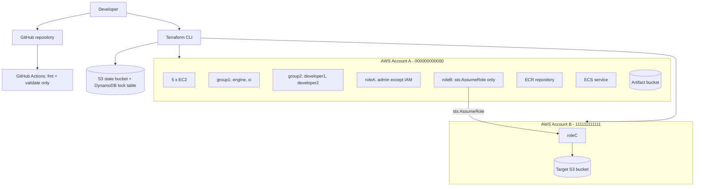
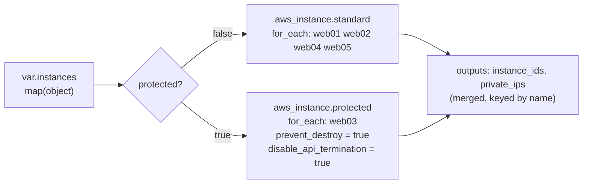
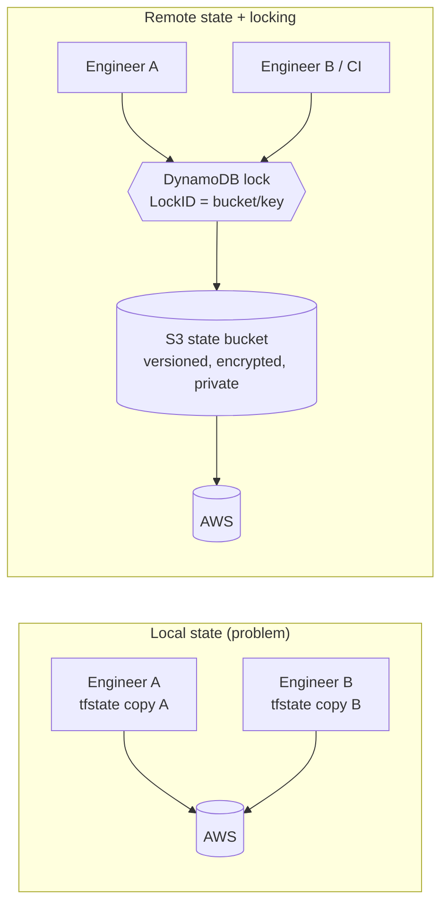
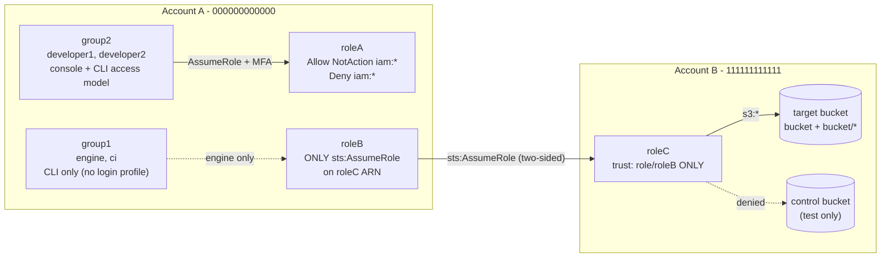
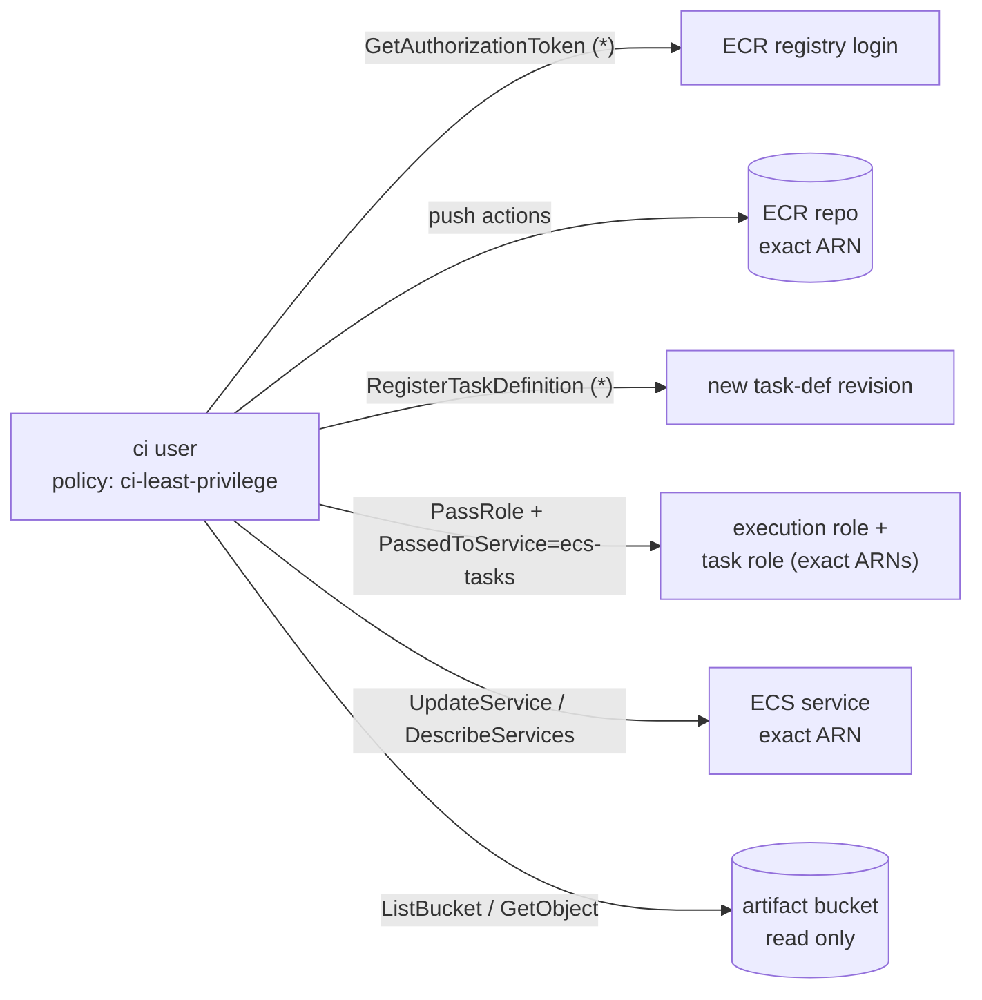
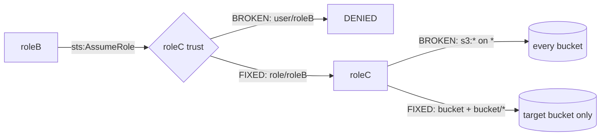

# aws-terraform-devops-assignment

Multi-account AWS infrastructure with Terraform: EC2 fleet, remote state with
locking, multi-account IAM, a least-privilege CI policy and a trust-policy bug fix.

> **Validation status:** code is developed and validated locally
> (`fmt`, `init -backend=false`, `validate`). **No `terraform apply` has been run
> against a real AWS account yet.** Real-AWS POC steps are documented separately
> and clearly marked.

## 1. Project overview

| Task | Topic | Status |
|---|---|---|
| 0 | Repository bootstrap, guardrails, safe CI | Done (local) |
| 1 | Five EC2 instances from one `map(object)` + `for_each`, `prevent_destroy` | Done (local POC); real-AWS POC pending |
| 2 | S3 remote state + DynamoDB locking (bootstrap stack) | Done (local POC); real-AWS POC pending |
| 3 | Multi-account IAM: groups, users, roleA, roleB, roleC | Done (local POC); real-AWS POC pending |
| 4 | CI least-privilege policy (ECR / ECS / S3 read) | Done (local POC); real-AWS POC pending |
| 5 | Find and fix the roleC trust and S3 policy bugs | Done (local POC); real-AWS POC pending |

## 2. Assignment requirements

See [NOTES.md](NOTES.md) for the written answers. `FINAL-CHECKLIST.md` (created at
the end) maps every requirement to its implementation and evidence.

## 3. Architecture



Details: [docs/architecture.md](docs/architecture.md).

## 4. Repository structure

```
bootstrap/     state bucket + lock table (local state, run once)
modules/ec2/   reusable multi-instance EC2 module
account-a/     Account A root module (EC2, IAM, roleA, roleB, CI policy)
account-b/     Account B root module (roleC, target bucket)
policies/      standalone JSON policy documents
tests/         per-task test procedures and evidence
docs/          architecture, testing, troubleshooting
scripts/       local helper scripts (Windows PowerShell)
.github/       CI workflow (safe checks only)
```

## 5. Prerequisites

| Tool | Version | Install (Windows) |
|---|---|---|
| Terraform | >= 1.5, < 2.0 | `winget install --id HashiCorp.Terraform -e` |
| Git | recent | `winget install --id Git.Git -e` |
| AWS CLI v2 | real-AWS phase only | `winget install --id Amazon.AWSCLI -e` |

Keep the repository at a short path (for example `C:\work\...`) to avoid the Windows
260-character path limit.

## 6. Task 1 - EC2 module

**Files:** `modules/ec2/{versions,variables,main,outputs}.tf`, `account-a/ec2.tf`,
`account-a/outputs.tf`, `account-a/terraform.tfvars.example`.

### One variable -> five instances



| Name | Type | Root volume | IOPS / throughput | Key pair | Environment | Protected |
|---|---|---|---|---|---|---|
| web01 | t3.micro | gp3 20 GiB | baseline 3000 / 125 | web01-key | dev | no |
| web02 | t3.small | gp2 30 GiB | size-derived | web02-key | dev | no |
| web03 | t3.medium | **io2** 50 GiB | 3000 | web03-key | **prod** | **yes** |
| web04 | t3.large | gp3 80 GiB | 6000 / 250 MiB/s | web04-key | dev | no |
| web05 | t3.xlarge | **io1** 100 GiB | 4000 | web05-key | dev | no |

Every instance also gets: `Name`, `Environment`, `Owner` tags (on the instance and the
root volume), an encrypted root volume, and IMDSv2 (`http_tokens = "required"`).

### Volume validity (checked against AWS limits, enforced by validation blocks)

| Type | Size | IOPS | Throughput | Boot volume? |
|---|---|---|---|---|
| gp2 | 1-16384 GiB | derived (3/GiB), not settable | - | yes |
| gp3 | 1-16384 GiB | 3000-16000, max 500/GiB | 125-1000 MiB/s, max IOPS/4 | yes |
| io1 | 4-16384 GiB | 100-64000, max 50/GiB | - | yes |
| io2 | 4-65536 GiB | 100-256000, max 1000/GiB | - | yes |
| st1 / sc1 | - | - | - | **no** (rejected) |

The requested examples were valid, except that web05 "another valid configuration"
could NOT be st1/sc1 (HDD types cannot boot). io1 was chosen for web05, so both
provisioned-IOPS types are exercised. The gp3 IOPS/throughput caps are the
conservative published limits, so check the AWS docs if you need more.

### prevent_destroy - the valid design

`lifecycle` arguments must be literals, so `prevent_destroy = each.value.protected`
fails (`Error: Variables not allowed`). The single input map is split with two
`for` filters into two `for_each` resource blocks. Configuration stays data-driven:
protecting an instance is `protected = true` in the map. Tradeoffs:

- Two near-identical blocks must be kept in sync (not five).
- Moving an instance between groups changes its address. Use a `moved` block, or
  Terraform plans destroy + create (which `prevent_destroy` then blocks, as intended).
- `prevent_destroy` only guards Terraform. `disable_api_termination` guards AWS
  console/CLI too. Deleting the whole resource block from code removes the guard.

### AMI selection

`ami_id` is a variable with no default because AMI IDs are region-specific. For a real run:

```powershell
aws ssm get-parameter --region us-east-1 --name /aws/service/ami-amazon-linux-latest/al2023-ami-kernel-default-x86_64 --query Parameter.Value --output text
```

The AMI must be x86_64 because all types are t3. In production, pin a vetted AMI
(or look it up with `data "aws_ssm_parameter"` / `data "aws_ami"`) and roll it
deliberately. A new AMI forces replacement, which `prevent_destroy` blocks for web03.

### Key pairs

`key_name` references key pairs that must already exist in the region. Terraform
does not generate private keys, so none ever land in state or Git. See
`tests/task1-test.md` for creating them.

### Local POC

```powershell
powershell -ExecutionPolicy Bypass -File .\scripts\task1-local-poc.ps1
```

This runs an offline plan (mock credentials, zero AWS calls) with plan-JSON assertions, 7
negative-input fixtures, and a `prevent_destroy` mechanism demo. Real-AWS steps
are in `tests/task1-test.md`.

## 7. Task 2 - Remote state and locking

**Files:** `bootstrap/{main,outputs,variables}.tf`, `account-a/backend.tf`,
`account-b/backend.tf`, `*/backend.hcl.example`.

### Why remote state

With local state, every engineer has a private copy of the truth. That leads to
duplicate resources, overwritten changes, orphans, and no protection against two
applies at once. See NOTES.md Q2/Q3.



### Bootstrap (chicken-and-egg)

`bootstrap/` runs **once with local state** and creates the backend:

| Resource | Hardening |
|---|---|
| S3 bucket `<project>-tfstate-<account>` | versioning, SSE (AES256 or KMS), 4x public access block, ACLs disabled, TLS-only policy, old versions kept 90 days (newest 10 always), `force_destroy = false`, `prevent_destroy` |
| DynamoDB `<project>-tf-locks` | hash key `LockID` (S), on-demand billing, PITR, SSE, deletion protection, `prevent_destroy` |

### Backend configuration

Backend blocks can't use variables, so each stack uses a **partial configuration**:

| | `backend.tf` (committed) | `backend.hcl` (git-ignored, from `.example`) |
|---|---|---|
| account-a | `key = "account-a/terraform.tfstate"`, `encrypt = true` | bucket, region, dynamodb_table, profile |
| account-b | `key = "account-b/terraform.tfstate"`, `encrypt = true` | same bucket/table, `profile = "account-a"` |

Both stacks share one bucket and one table but use **different keys**, which gives
separate state files and separate lock items. The bucket is in Account A, so the
account-b *backend* uses Account A credentials while its *provider* uses Account B.

### init modes

| Command | When |
|---|---|
| `terraform init -backend-config=backend.hcl` | first init / fresh clone |
| `... -migrate-state` | move existing (e.g. local) state into S3 |
| `... -reconfigure` | backend settings changed, state must NOT be copied |
| `terraform init -backend=false` | local validation and CI (never touches S3) |

For information only: Terraform 1.10+ also offers native S3 locking
(`use_lockfile`), and 1.11 deprecated `dynamodb_table`. This repo implements the
**DynamoDB `LockID` table** that the assignment requires. Notes on a later
migration are in NOTES.md.

### Local POC

```powershell
powershell -ExecutionPolicy Bypass -File .\scripts\task2-local-poc.ps1
```

This covers an offline plan of `bootstrap/` with 14 hardening assertions, the KMS
toggle, negative inputs, backend key and config consistency, a check that `init`
without credentials can't silently fall back to local state, and a local-backend
demo in which Terraform refuses a competing local-state writer.

The local demo does **not** prove DynamoDB locking. These stay **REAL AWS POC: PENDING**
(`tests/task2-test.md`):

- S3 remote state actually created
- DynamoDB state locking actually exercised
- two concurrent Terraform operations tested against AWS

| Locking approach | Status in this repo |
|---|---|
| S3 backend + DynamoDB `LockID` table | **Implemented, required by the assignment** |
| Native S3 locking (`use_lockfile`, Terraform 1.10+) | Informational only, not a replacement for the assignment requirement |

## 8. Task 3 - Multi-account IAM

**Files:** `account-a/{iam-users-groups,role-a,role-b}.tf`, `account-b/{s3,role-c,outputs}.tf`.



| Requirement | Implementation |
|---|---|
| group1 engine + ci, CLI only | no `aws_iam_user_login_profile`; Terraform creates **no access keys** |
| group2 two users, console + CLI | `developer1`, `developer2`: permissions for self-service password, access keys and MFA on their own user only, plus roleA with MFA. **Credential provisioning is intentionally kept out of Terraform state.** Login profiles are created only when `console_pgp_key` is set (encrypted password only). Otherwise console passwords and CLI keys are provisioned out of band. |
| roleA admin except IAM | custom policy `Allow NotAction iam:*` + explicit `Deny iam:*`, **not** AdministratorAccess; MFA-gated for group2 |
| roleB only `sts:AssumeRole` on roleC | one inline statement, exact ARN `arn:aws:iam::<B>:role/roleC`, nothing else |
| roleC trusts only roleB | Principal = `arn:aws:iam::<A>:role/roleB` (not `:root`, not `:user/roleB`) |
| roleC full access to one bucket | `s3:*` on `arn:aws:s3:::BUCKET` **and** `arn:aws:s3:::BUCKET/*`, never `*` |
| no secrets in outputs or state | no access keys created; no plaintext console password ever in state or outputs (PGP-encrypted only, or not managed by Terraform) |

**Apply order:** account-a first, then account-b. IAM validates that roleC's
trusted principal (roleB) exists.

### Local POC

```powershell
powershell -ExecutionPolicy Bypass -File .\scripts\task3-local-poc.ps1
```

This runs offline plans of both accounts and structural checks on the **rendered**
policy JSON (exact principal, no root trust, bucket scoping, roleB minimal, no
access keys). It then evaluates the assignment's tests A-E with a **simplified IAM
model** (`scripts/IamPolicyModel.psm1`, which is not AWS), including a
counterfactual that shows Account A root trust would admit roleA and the root user.

**REAL AWS POC: PENDING.** The actual `engine -> roleB -> AssumeRole -> roleC -> S3`
calls between two accounts are in `tests/task3-test.md`.

## 9. Task 4 - CI least-privilege policy

**Files:** `account-a/ci-policy.tf`, `policies/ci-policy.json` (reference copy,
drift-checked), `policies/README.md`.



| Requirement | Implementation |
|---|---|
| Push to ONE ECR repo | 6 push actions on the exact repository ARN, plus `GetAuthorizationToken` (`*` required) |
| Deploy to ONE ECS service | `RegisterTaskDefinition` (`*` required) + `UpdateService`/`DescribeServices` on the exact service ARN |
| Task roles | `iam:PassRole` on the exact execution- and task-role ARNs, `iam:PassedToService = ecs-tasks.amazonaws.com` |
| Read ONE artifact bucket | `s3:ListBucket` on the bucket ARN, `s3:GetObject` on `bucket/*`. No write or delete |
| No broad policies | custom policy only, attached to the `ci` user only |

`Resource "*"` appears only for `ecr:GetAuthorizationToken` and
`ecs:RegisterTaskDefinition`, where AWS offers no resource-level scoping. Each is
isolated in its own single-action statement. Excluded permissions and the reasons
are in NOTES.md Q7/Q8.

The ECR repository, ECS service, task roles and bucket are **not** created here.
They are named by `ci_*` variables and the exact ARNs are built from them.

### Local POC

```powershell
powershell -ExecutionPolicy Bypass -File .\scripts\task4-local-poc.ps1
```

This checks the policy structure, the rendered JSON (identical to
`policies/ci-policy.json`), the wildcard exceptions, that no broad managed
policies or excluded actions are present, the access matrix A-Q with the
**simplified IAM model** (POC model only), and that wildcard target names are
rejected. **Real ECR push / ECS deploy / PassRole / S3 read: REAL AWS POC PENDING**
(`tests/task4-test.md`).

## 10. Task 5 - Bug fix

**Files:** `tests/fixtures/task5/` (broken and fixed policies, **test data only**),
`scripts/task5-local-poc.ps1`, `tests/task5-test.md`. The deployable fix is the
Task 3 code in `account-b/role-c.tf`, which is not changed by Task 5.

| Bug | Broken (original) | Fixed (deployed) | Effect of the bug |
|---|---|---|---|
| 1 - wrong principal type | `arn:aws:iam::000000000000:user/roleB` | `arn:aws:iam::000000000000:role/roleB` | roleB is a **role**, but the principal ARN identifies a **user**. It is the wrong principal for the intended trust, so roleB -> roleC is denied |
| 2 - over-permission | `s3:*` on `Resource "*"` | `s3:*` on `arn:aws:s3:::BUCKET` + `arn:aws:s3:::BUCKET/*` | roleC could read, write, delete and re-policy **every** bucket instead of one |



### Local POC

```powershell
powershell -ExecutionPolicy Bypass -File .\scripts\task5-local-poc.ps1
```

This proves four things, using the simplified IAM model (POC model only):
1. The broken trust denies the real roleB (identity=Allow, trust=Deny).
2. The broken S3 policy is over-broad.
3. The fixed fixtures and the deployed Terraform produce the intended matrix
   (target bucket and objects allowed, unrelated bucket and objects denied).
4. Deployable Terraform contains neither broken pattern, never references the
   fixtures, and the fixed fixtures match the rendered policies.

**Real-AWS before/after tests: PENDING** (`tests/task5-test.md`, run against a
disposable `roleC-bugtest` role, never the real roleC).

## 11. Local setup

```powershell
Set-Location C:\work\aws-terraform-devops-assignment
Set-ExecutionPolicy -Scope Process Bypass
.\scripts\validate-local.ps1
```

## 12. AWS setup

Order matters (details in `tests/task2-test.md`):

1. CLI profiles `account-a` and `account-b` (IAM Identity Center: `aws configure sso --profile account-a`).
2. `bootstrap/`: copy `terraform.tfvars.example` to `terraform.tfvars`, set the real account ID, then
   `$env:AWS_PROFILE='account-a'; terraform init; terraform apply` (local state).
3. `account-a/` and `account-b/`: copy `backend.hcl.example` to `backend.hcl` (values from
   `terraform -chdir=bootstrap output backend_hcl`), then `terraform init -backend-config=backend.hcl`.
4. Apply the stacks (Tasks 1, 3, 4).

## 13. Terraform commands

| Command | Purpose | Needs AWS? |
|---|---|---|
| `terraform fmt -check -recursive` | Formatting gate | No |
| `terraform init -backend=false` | Download providers, skip backend | No (internet only) |
| `terraform validate` | Syntax and type checks | No |
| `terraform init -backend-config=backend.hcl` | Connect to the S3 backend | Yes |
| `terraform init -backend-config=backend.hcl -migrate-state` | Move existing state into S3 | Yes |
| `terraform init -backend-config=backend.hcl -reconfigure` | Switch backend config without copying state | Yes |
| `terraform plan` / `apply` | Real deployment | Yes |
| `terraform plan -lock-timeout=120s` | Wait for another operation's DynamoDB lock instead of failing | Yes |
| `terraform force-unlock <ID>` | Release a stale lock (holder confirmed dead) | Yes |

## 14. Testing

Full local regression (repository gates and POC-1..POC-5, with raw logs in
`tests/evidence/local/`):

```powershell
powershell -ExecutionPolicy Bypass -File .\scripts\run-regression.ps1
```

Details are in [docs/testing.md](docs/testing.md) and per-task procedures in [tests/](tests/).
Every task has a **LOCAL POC (PASS)** and a **REAL AWS POC (PENDING)**.

## 15. Security considerations

- State, tfvars, keys and `.terraform/` are git-ignored; CI fails if they are tracked.
- No AWS credentials are stored in GitHub; future CI/CD uses GitHub OIDC.
- `allowed_account_ids` pins each stack to its intended account.
- CI never runs `plan` or `apply`.
- Remote state is encrypted, versioned, private, TLS-only, locked with DynamoDB, and protected from deletion.
- Real `backend.hcl` (bucket name / account ID / profile) is git-ignored like `terraform.tfvars`.
- IAM: no `AdministratorAccess` shortcut, no access keys in Terraform/state, exact-ARN trust
  policies (never Account A root for roleC), `Resource "*"` only where technically justified
  (roleA admin role, `iam:GetAccountPasswordPolicy`).

## 16. Cleanup

- **Task 1:** web03 cannot be destroyed by `terraform destroy` (by design). Move it to
  the standard group with a `moved` block + `protected = false`, apply, then destroy.
  Full procedure: `tests/task1-test.md` section 3.
- **Task 3:** destroy account-b (roleC, buckets) before account-a (roleB), and delete any
  access keys created for testing (`tests/task3-test.md`). The target bucket must be
  emptied first (versioned). The control bucket has `force_destroy`.
- **Task 2:** destroy the state backend LAST, after every stack using it. It is protected
  three ways (prevent_destroy, deletion protection, `force_destroy = false`). Procedure:
  `tests/task2-test.md` section 3.

## 17. Troubleshooting

See [docs/troubleshooting.md](docs/troubleshooting.md).
