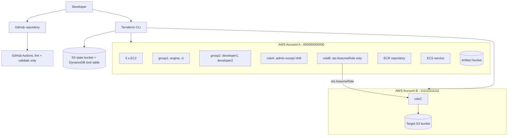

# aws-terraform-devops-assignment

Multi-account AWS infrastructure with Terraform: EC2 fleet, remote state with
locking, multi-account IAM, a least-privilege CI policy and a trust-policy bug fix.

> **Validation status:** code is developed and validated locally
> (`fmt`, `init -backend=false`, `validate`). **No `terraform apply` has been run
> against a real AWS account yet.** Real-AWS POC steps are documented separately
> and clearly marked.

## 1. Project overview

| Task | Topic | Status |
|---|---|---|
| 0 | Repository bootstrap, guardrails, safe CI | Done (local) |
| 1 | Five EC2 instances from one `map(object)` + `for_each`, `prevent_destroy` | Planned |
| 2 | S3 remote state + DynamoDB locking (bootstrap stack) | Planned |
| 3 | Multi-account IAM: groups, users, roleA, roleB, roleC | Planned |
| 4 | CI least-privilege policy (ECR / ECS / S3 read) | Planned |
| 5 | Find and fix the roleC trust and S3 policy bugs | Planned |

## 2. Assignment requirements

See [NOTES.md](NOTES.md) for the written answers. `FINAL-CHECKLIST.md` (created at
the end) maps every requirement to its implementation and evidence.

## 3. Architecture



Details: [docs/architecture.md](docs/architecture.md).

## 4. Repository structure

```
bootstrap/     state bucket + lock table (local state, run once)
modules/ec2/   reusable multi-instance EC2 module
account-a/     Account A root module (EC2, IAM, roleA, roleB, CI policy)
account-b/     Account B root module (roleC, target bucket)
policies/      standalone JSON policy documents
tests/         per-task test procedures and evidence
docs/          architecture, testing, troubleshooting
scripts/       local helper scripts (Windows PowerShell)
.github/       CI workflow (safe checks only)
```

## 5. Prerequisites

| Tool | Version | Install (Windows) |
|---|---|---|
| Terraform | >= 1.5, < 2.0 | `winget install --id HashiCorp.Terraform -e` |
| Git | recent | `winget install --id Git.Git -e` |
| AWS CLI v2 | real-AWS phase only | `winget install --id Amazon.AWSCLI -e` |

Keep the repository at a short path (for example `C:\work\...`) to avoid the Windows
260-character path limit.

## 6. Task 1 - EC2 module

_Implemented in Task 1._

## 7. Task 2 - Remote state and locking

_Implemented in Task 2._

## 8. Task 3 - Multi-account IAM

_Implemented in Task 3._

## 9. Task 4 - CI least-privilege policy

_Implemented in Task 4._

## 10. Task 5 - Bug fix

_Implemented in Task 5._

## 11. Local setup

```powershell
Set-Location C:\work\aws-terraform-devops-assignment
Set-ExecutionPolicy -Scope Process Bypass
.\scripts\validate-local.ps1
```

## 12. AWS setup

_Documented in Tasks 2-3 (real-AWS phase)._

## 13. Terraform commands

| Command | Purpose | Needs AWS? |
|---|---|---|
| `terraform fmt -check -recursive` | Formatting gate | No |
| `terraform init -backend=false` | Download providers, skip backend | No (internet only) |
| `terraform validate` | Syntax and type checks | No |
| `terraform plan` / `apply` | Real deployment | Yes |

## 14. Testing

See [docs/testing.md](docs/testing.md) and [tests/](tests/).

## 15. Security considerations

- State, tfvars, keys and `.terraform/` are git-ignored; CI fails if they are tracked.
- No AWS credentials are stored in GitHub; future CI/CD uses GitHub OIDC.
- `allowed_account_ids` pins each stack to its intended account.
- CI never runs `plan` or `apply`.

## 16. Cleanup

_Documented once resources exist (Tasks 1-4)._

## 17. Troubleshooting

See [docs/troubleshooting.md](docs/troubleshooting.md).
