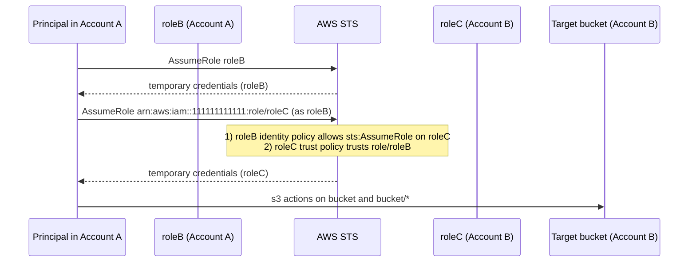
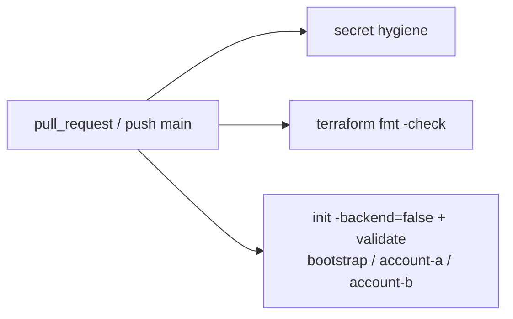

# Architecture

## Accounts

| Account | ID (placeholder) | Terraform root | Contents |
|---|---|---|---|
| A | `000000000000` | `account-a/` | EC2 fleet, group1 (engine, ci), group2 (developer1, developer2), roleA, roleB, ECR, ECS, artifact bucket access |
| A (state) | `000000000000` | `bootstrap/` | S3 state bucket, DynamoDB lock table |
| B | `111111111111` | `account-b/` | roleC, target S3 bucket |

Account IDs are variables (`account_a_id`, `account_b_id`, `state_account_id`). Each
provider sets `allowed_account_ids`, so a stack cannot be applied to the wrong account.

## Cross-account flow



## State layout (Task 2)

```
s3://<state-bucket>/account-a/terraform.tfstate
s3://<state-bucket>/account-b/terraform.tfstate
bootstrap/  -> local state (it creates the backend itself)
```

## CI (safe mode)



No AWS credentials. No plan. No apply.

## Naming and tagging

- Resources: `<project>-<purpose>`, lowercase with hyphens.
- Tags on every resource via `default_tags`: `Project`, `Environment`, `Owner`, `ManagedBy`, `Stack`.
